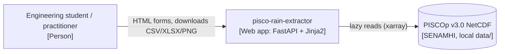
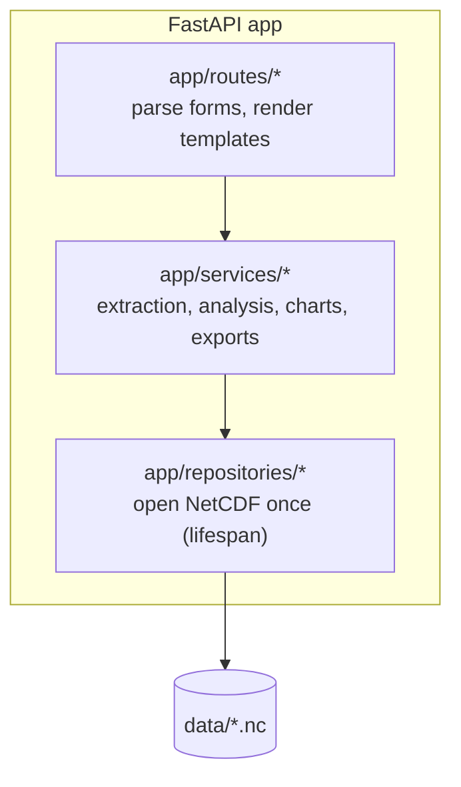

# C4 diagrams

Explain the architecture with the smallest C4 level that answers the question.
Diagrams are Mermaid code blocks embedded in Markdown, so they render on GitHub and
stay diff-friendly. No images, no external tools.

## Choose the level
| Level | Use when | Shows |
|---|---|---|
| 1. System context | First change of the project; new external actor or data source | User, the web app, PISCOp files (SENAMHI) |
| 2. Container | Runtime or deployment changes | Browser, FastAPI/Uvicorn process, `data/` NetCDF files |
| 3. Component | The change crosses layers | Routes → services → repositories inside the app |

Never draw level 4 (code); the contracts in `design.md` already cover it.

## Rules
- Respect the layered architecture: arrows go `routes -> services -> repositories`, never back.
  Only repositories touch `data/`. If the diagram needs another arrow, stop: it requires an ADR.
- Name elements with the real paths/modules (`app/services/extraction.py`), not generic labels.
- Label each arrow with what flows (`form POST`, `lat, lon, dates`, `xarray slice`, `PNG`).
- Keep each diagram under ~12 elements; split if larger.
- Add one sentence below each diagram saying what it shows and what it omits.

## Templates

Level 1 – System context:

Level 3 – Components:

## Where to put it
- In `openspec/changes/<change>/design.md` under a `## Architecture` heading.
- In an ADR, under `## Context` or `## Decision`, when the diagram justifies the decision.
