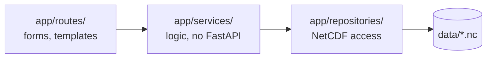

# ADR-0004: Adopt a layered architecture with a NetCDF repository

- **Status:** Accepted
- **Date:** 2026-10-24
- **Deciders:** Project owner
- **Supersedes:** -
- **Related change:** -

## Context

The app combines HTTP form handling, scientific computation (extraction, annual and
monthly statistics, charts, exports) and access to large third-party NetCDF files.
Mixing these concerns makes the computation hard to unit-test and spreads file access
(and memory risks) across the code. Tests must run without the real SENAMHI files.

## Options considered

1. **Layered: routes → services → repositories** – routes parse input and render,
   services hold the logic, a repository is the only code that opens NetCDF files.
2. **Fat routes** – logic inside FastAPI handlers; fewer files, but untestable without
   HTTP and duplicated across pages.
3. **Hexagonal (ports and adapters)** – very clean, but more abstractions than a
   single-data-source app needs.

## Decision

We will use three layers with one-way dependencies:

- `app/routes/`: parse form input, call services, render templates. No business logic.
- `app/services/`: extraction, analysis, coordinates, charts, exports. Never import FastAPI.
- `app/repositories/`: the **only** place that opens or reads NetCDF files (`data/`).
- Dependencies point only downward; services receive the repository as a parameter
  so tests can pass one built on synthetic fixtures.

Rejected: fat routes – logic not testable in isolation. Rejected: hexagonal – extra
interfaces with no second data source to justify them.

## Consequences

- **Positive:** services unit-tested with synthetic data; one place to control memory use.
- **Negative / trade-offs:** some pass-through code between layers.
- **Follow-up:** `/adr-review` checks for `xarray`/`open_dataset` outside
  `app/repositories/` and `fastapi` imports in `app/services/`.
