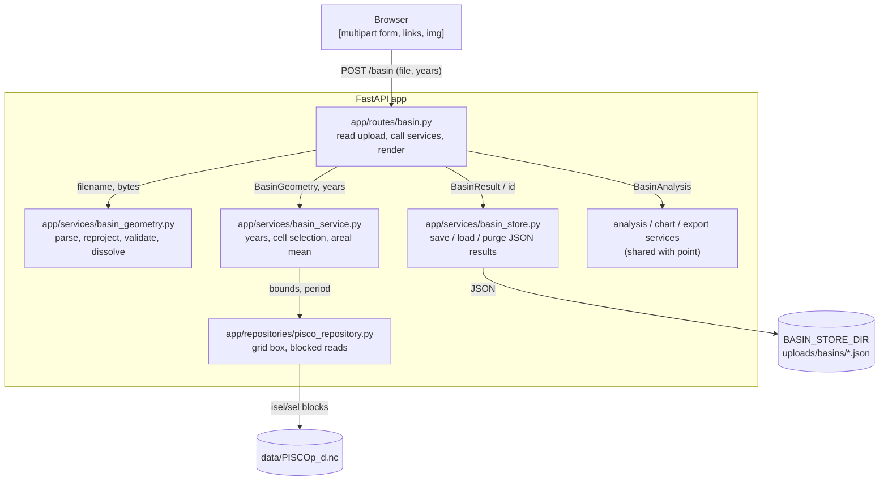

# Design

## Context

See proposal.md for the motivation and specs/ for the behavior. Current state that shapes
the approach:

- Point results are stateless GET URLs that re-read one cell per request (ADR-0013). That
  ADR covers point results only; it stays in force and is not changed by this design.
- `analysis_service`, `chart_service` and `export_service` take a `PointAnalysis` whose
  `result` is a `PointResult`. Daily, annual and climatology code only uses
  `result.series`, `result.start_year`, `result.end_year`, `annual` and `climatology`.
- The repository already has `lat_slice` (ADR-0010), `_nearest_index` with the ADR-0011 tie
  rule, `grid_extent()` and `nearest_cell()`. Coordinates are 1-D and read at open time.
- geopandas 1.2 (pyogrio 0.13 engine), shapely 2.2 and pyproj 3.8 are already installed.
- Measured on the real `PISCOp_d.nc`: precipitation is float32, shape (16436, 210, 174),
  zlib level 4, chunks (2740, 35, 29), so one chunk is 11.1 MB decompressed. A full-period
  read of a 10 × 10 box takes 0.67 s (6.6 MB) and a 30 × 30 box takes 1.55 s (59 MB), cold.
  A 50 × 50 box for the full period would be 164 MB in one read.

## Goals / Non-Goals

**Goals:**
- One NetCDF pass per basin request, bounded memory, independent of the period length.
- Reuse the point analysis, charts and export format without changing point behavior.
- Uploaded files never touch the repository; stored results expire on their own.

**Non-Goals:**
- Area weighting, interpolation or partial-cell fractions.
- Caching or changing the point routes.
- A JavaScript map; the map is a server-side PNG like the other charts.

## Architecture



Components of this change only; the point routes and the dataset page are omitted. Arrows
follow routes → services → repositories; the store writes user results, never `data/`.

## Decisions

### D1. Basin results are stored server-side under a UUID-validated id for 24 hours — [ADR-0018](../../../adr/0018-store-basin-results-server-side-under-a-uuid-validated-id-with-a-24-hour-expiry.md)

The POST validates, reads the bounding box once, computes the result and saves it as one JSON
file `<id>.json` in `BASIN_STORE_DIR` (default `uploads/basins/`, gitignored). `<id>` is
`uuid4().hex` (32 lowercase hex characters, 122 random bits). It then redirects (303) to
`/basin/result/<id>`. Result pages, charts and downloads load that file and never read
NetCDF. The file holds: format version, basin file name (base name only, at most 100
characters), feature count, dissolved WGS84 geometry as GeoJSON, area, centroid, fallback
flag, resolution, cells (lon, lat, used, valid days), years, period start and the areal series
values (`null` for missing), about 0.3 MB for 45 years.

- Ids are validated by `is_result_id(text) -> bool`: the value must match
  `^[0-9a-f]{12}4[0-9a-f]{3}[89ab][0-9a-f]{15}$` and round-trip through `uuid.UUID(text).hex`.
  The routes call it before using the store, and `BasinStore.load` calls it again before it
  builds a `Path`. A rejected value causes no file-system call (stat, open, list or delete)
  on the store or on any path derived from it, so a path traversal such as
  `../../pyproject.toml` cannot name any file. Unrelated I/O, such as Jinja checking its own
  templates (auto-reload stays on), is outside this rule.
- An unknown, expired or invalid id gets the same 404 `basin.html` page with "This result has
  expired; upload the basin again" and a link to `/basin`. One message for all three cases
  means probing ids reveals nothing. Chart and download URLs return a plain 404.
- Writes go to a temporary file in the same directory followed by `os.replace` (atomic).
- Expiry uses the file modification time: files older than `BASIN_TTL_HOURS` (default 24)
  are deleted at startup and before each save, and a load of an expired file deletes it and
  answers "not found".
- The uploaded bytes are kept in memory only (see D2); they are never stored.

Rejected: **stateless URL with an encoded cell mask and a simplified outline**. It keeps
links permanent, but each of the up to 6 requests of a result view would re-read the box
(1.5 s each at 30 × 30), URLs of several KB approach the 16 KB request-line limit of h11, the
outline on the map would be simplified, and area and notices could be edited in the URL.
Rejected: **everything in the POST response** (inline base64 charts, data-URI downloads).
There is no state, but the page weighs several MB, cannot paginate or be bookmarked, and any
change needs a new upload; ADR-0013 already rejected inline base64.

Recorded in ADR-0018, which supersedes ADR-0015 (the stricter id rule and the expired page)
and complements ADR-0013 (point results stay stateless).

Rejected for the id check: **resolving the path and checking it stays inside the store**.
It touches the disk to reject input that the whitelist rejects for free.

### D2. Uploads are parsed in memory and validated in a fixed order

Order (first failure wins, so a bad year never parses a file): years (same messages as the
point form) → file chosen → extension (`.geojson`, `.json`, `.zip`, case-insensitive) → size
(≤ 10,485,760 bytes) → archive checks → parse → CRS → geometry → grid → size limit → read.

- The route reads at most `MAX_UPLOAD_BYTES + 1` bytes from the `UploadFile`, so a larger
  file is detected without reading it whole. Starlette may spool a large part to the system
  temporary directory; Starlette deletes it when the request ends.
- ZIP: inspected with `zipfile` on a `BytesIO`. Rejected when a member name is absolute or
  contains `..`, when there is not exactly one `.shp`, when `.shx`, `.dbf` or `.prj` of the
  same stem is missing (`.prj` has its own message), when there are more than 50 members or
  the total uncompressed size exceeds 100 MB (zip-bomb guard).
- Reading: `geopandas.read_file(BytesIO(content))` with the pyogrio engine, which reads
  GeoJSON and zipped Shapefiles from memory through GDAL's virtual file system. Any read error
  becomes "The file could not be read as GeoJSON" or "… as a zipped Shapefile".
- CRS: a Shapefile CRS comes from its `.prj`; an unparsable `.prj` gives "The .prj file does
  not describe a known coordinate system". A GeoJSON without a declared CRS is WGS84
  (RFC 7946). Anything not EPSG:4326 is reprojected with `to_crs(4326)`.
- Geometry: drop null and empty geometries; none left → "The file contains no polygon"; any
  non-polygonal type → "The basin must be a polygon or multipolygon"; any invalid geometry →
  "The basin geometry is invalid: " + `shapely.is_valid_reason`. Invalid geometries are not
  repaired, because `make_valid` can silently change the basin. Several features are
  dissolved with `shapely.union_all` and the count is reported.

Rejected: extracting the ZIP to a temporary directory. It works with any GDAL build but puts
user data on disk and needs path-traversal handling on extraction; in-memory reading avoids
both. Rejected: repairing invalid geometries with `make_valid`: the user would not know the
basin changed.

### D3. Cell selection: centers inside, centroid fallback in UTM

1. Domain check: the basin must intersect the grid extent box (ADR-0011 outer edges),
   otherwise "outside the PISCOp grid". The bounds used next are the basin bounds clipped
   to that extent.
2. Bounding box: the repository returns the rows and columns whose rounded centers lie within
   the clipped bounds. Latitude goes through `lat_slice` (ADR-0010); longitude through a new
   `lon_slice` with the same tolerance, which asserts the ascending order ADR-0010 documents.
   Only 1-D coordinates are used.
3. Size limit (D5): `rows * cols > 2500` → 422 before any read.
4. Inside test: `shapely.covers(basin, shapely.points(lon, lat))` on the box centers rounded
   to 4 decimals (as `CellRef`), so a center exactly on the boundary is inside and float32
   noise cannot drop it.
5. Fallback, when no center is inside: project the basin to UTM, EPSG `32700 + zone` with
   `zone = floor((lon_mid + 180) / 6) + 1` from the box center longitude (17, 18 or 19 in
   Peru, southern-hemisphere codes as in the project context), take the planar centroid, and
   project it back to WGS84. If the centroid is outside the extent → "outside the PISCOp
   grid"; otherwise `repo.nearest_cell` gives the cell with the ADR-0011 tie rule, and the
   box shrinks to that single cell.

Area: `pyproj.Geod(ellps="WGS84").geometry_area_perimeter` on the full basin (not clipped),
absolute value in km², rounded to 1 decimal. It is geodesic, so it does not depend on the UTM
zone.

Rejected: centroid in geographic coordinates (the request requires UTM; degrees are not
isotropic). Rejected: area in UTM, which distorts basins that cross a zone boundary.
Rejected: selecting cells that intersect the basin: that is area weighting by another name and
belongs to the BACKLOG option.

### D4. Areal mean of valid cells, all-missing cells excluded — [ADR-0016](../../../adr/0016-compute-the-basin-areal-mean-as-the-arithmetic-mean-of-valid-cells-whose-centers-fall-inside.md)

Per day: `sum(valid values) / count(valid values)` over the selected cells, computed with
`np.nansum` and a valid count (no `nanmean` warning on all-missing days); a day with no valid
value is NaN. Per cell, valid days are accumulated over the period; cells with zero valid
days are marked excluded and listed. They never change the mean, because they never have a
value. If every selected cell is excluded, the result is "No data available for this basin"
and nothing is stored. Aggregates (annual, climatology, completeness) are computed on the
areal series with the ADR-0012 rules, exactly as for a point.

Rejected: **area-weighted mean** (cell fraction inside the basin, or cos(latitude)
weights): more accurate for small or narrow basins, but needs cell polygons and a weighting
ADR; recorded in `BACKLOG.md`. Rejected: **a day is missing if any cell is missing**: one
gappy cell would erase days for the whole basin. Rejected: **fill missing cells with
neighbors**: synthetic values, contrary to ADR-0006.

Recorded in ADR-0016 (together with the D3 selection rules and the basin file names of D6).

### D5. Bounding-box reads in chunk-aligned tiles, limit 2500 cells — [ADR-0020](../../../adr/0020-read-basin-bounding-boxes-in-chunk-aligned-tiles-through-the-shared-xarray-handle.md)

`iter_box_blocks` yields `(dates, values)` for consecutive time blocks of the requested period,
aligned with the time chunks of the daily variable (`encoding["chunksizes"]`, 2740 days in the
real file, or 1461 days when the variable is not chunked). Within a block, the repository makes
one xarray `isel` per spatial chunk the box touches and writes it into the block array (float32,
time × lat × lon). A variable that is not chunked in space is read as a single tile. xarray
decodes fill values and packing, as for point reads. The service reduces each block to its daily
areal values and per-cell valid counts, then drops it.

Memory strategy (every NetCDF read): one block at a time, one chunk per read, and the single
shared handle (ADR-0005). Its default HDF5 chunk cache keeps warm point reads fast (ADR-0013).
Measured on the real file for a 50 × 50 box over 1981–2025, idle process at 111 MB, each run in
a fresh process:
- One `isel` per block (ADR-0017): 302 MB.
- A second netCDF4 handle with no chunk cache (ADR-0019): 282 MB. HDF5 shares the dataset with
  the open xarray handle, so that cache setting has no effect.
- Chunk-aligned tiles through the xarray handle: **287 MB, 2.5 s**.

The remaining peak is the shared chunk cache (up to 64 MB), the 27 MB block and the areal-mean
temporaries (about 33 MB). The areal series itself is 16436 float64 values (130 KB).

The 2500 limit is on bounding-box cells, not on selected cells, because memory and time
follow the box. 2500 cells is about 5° × 5° (roughly 300,000 km²), large enough for the
Mantaro or Urubamba basins.

Rejected: **one read of the whole box** (164 MB at 50 × 50 for 45 years). Rejected: **dask**
(ADR-0005 requires an ADR, and blocks give the same bound with numpy). Rejected: **one xarray
`isel` per block** (ADR-0017, 302 MB). Rejected: **a second cache-less netCDF4 handle**
(ADR-0019, about 5 MB saved for a second handle and a second fill-value decoding).

`scripts/check_basin_memory.py` measures the peak working set (Windows
`K32GetProcessMemoryInfo` through `ctypes`, `resource.getrusage` elsewhere; no new
dependency) for a 50 × 50 box on the real file, so the limit rests on a measurement.

Recorded in ADR-0020, which supersedes ADR-0019 (and, through it, ADR-0017).

### D6. Shared analysis, charts and exports through an analysis union

- `analysis_service`: new `BasinAnalysis(result: BasinResult, annual, mean_annual,
  climatology)` built by `analyze_basin`, using the same `annual_stats`,
  `mean_annual_rainfall` and `monthly_climatology`. `Analysis = PointAnalysis | BasinAnalysis`.
  `BasinResult` has `series`, `start_year` and `end_year` like `PointResult`.
- `chart_service`: `ChartKind.CELLS` added; `POINT_CHARTS` and `BASIN_CHARTS` list the kinds
  each result accepts; `build_figure(kind, analysis: Analysis)`. The cells map draws the
  basin outline (exterior and holes as matplotlib patches from shapely coordinates; no
  pyplot, no `GeoSeries.plot`), cell edges, used centers in `SERIES_1` and excluded centers as
  hollow `TEXT_SECONDARY` markers, aspect `1 / cos(latitude)`.
- `export_service`: `ExportTable.CELLS` added (basin only); `table_frame(table, analysis:
  Analysis)`; `metadata_rows` dispatches to point and basin rows; `to_xlsx` writes the tables
  of the result type then `metadata`; `export_filename` names basin files
  `pisco_basin_<lat>_<lon>_<start>-<end>` from the centroid rounded to 3 decimals. ADR-0014
  defines point names only; this basin pattern is additive and keeps every format rule, so
  ADR-0014 is not superseded. It is recorded in ADR-0016.
- `point_service`: the year checks of `validate_point` move to a public
  `validate_years(repo, start_text, end_text) -> tuple[int, int]` with the same messages, used
  by both forms.

Rejected: a separate copy of the analysis for basins (two places for ADR-0012). Rejected: a
`Protocol` over both results: a two-member union is simpler and type-checks the same.

### D7. Templates share the analysis tabs

`point_result.html` and `basin_result.html` include a shared `_analysis_tabs.html` with the
Daily, Annual and Climatology sections, parameterized by `chart_base` and `page_base` URLs.
The point page output stays the same (its tests guard it). `basin.html` has
`enctype="multipart/form-data"`, `accept=".geojson,.json,.zip"`, and shows errors, the
no-data notice and the expired notice ("This result has expired; upload the basin again",
where "upload the basin again" links to `/basin`). Navigation gains "Basin".

## Contracts

### Routes (`app/routes/basin.py`)

| Method | Path | Input | Response |
|---|---|---|---|
| GET | `/basin` | – | 200 `basin.html` (form with default years, or unavailable message) |
| POST | `/basin` | form `basin_file: UploadFile \| None`, `start_year`, `end_year` | 303 → `/basin/result/<id>`; 422 `basin.html` with error; 200 `basin.html` with no-data notice |
| GET | `/basin/result/{result_id}` | query `page` (default 1) | 200 `basin_result.html`; 404 `basin.html` with expired notice (invalid id: before any disk access) |
| GET | `/basin/result/{result_id}/chart/{kind}.png` | – | 200 `image/png`; 404 invalid, unknown or expired id, or unknown kind |
| GET | `/basin/result/{result_id}/export/{table}.csv` | – | 200 CSV attachment; 404 invalid, unknown or expired id, or unknown table |
| GET | `/basin/result/{result_id}/export.xlsx` | – | 200 XLSX attachment; 404 invalid, unknown or expired id |

The store is created in the lifespan from settings (`app.state.basin_store`, purged at
startup) and injected with `BasinStoreDep`, like `RepositoryDep`.

### Settings (`app/config.py`)

```python
basin_store_dir: Path = Path("uploads/basins")   # env BASIN_STORE_DIR
basin_ttl_hours: int = 24                          # env BASIN_TTL_HOURS
```

### Repository (`app/repositories/pisco_repository.py`)

```python
@dataclass(frozen=True)
class GridBox:
    lat: np.ndarray        # rounded centers, file order
    lon: np.ndarray        # rounded centers, ascending
    south: float; north: float; west: float; east: float   # bounds used for the label slices

def lon_slice(lon: np.ndarray, west: float, east: float, tol: float = LAT_TOLERANCE_DEG) -> slice: ...

class PiscoRepository:
    def grid_box(self, west: float, south: float, east: float, north: float) -> GridBox: ...
    def cell_box(self, cell: CellRef) -> GridBox: ...
    def time_block_length(self) -> int: ...
    def iter_box_blocks(
        self, box: GridBox, start: date, end: date
    ) -> Iterator[tuple[pd.DatetimeIndex, np.ndarray]]: ...   # values: float32 (time, lat, lon)
```

### Services

```python
# app/services/basin_geometry.py
MAX_UPLOAD_BYTES = 10 * 1024 * 1024

class BasinInputError(ValueError): ...           # message shown to the user

@dataclass(frozen=True)
class BasinGeometry:
    filename: str
    features: int
    geometry: BaseGeometry                        # WGS84, dissolved, valid

def parse_basin_file(filename: str, content: bytes) -> BasinGeometry: ...
def geodesic_area_km2(geometry: BaseGeometry) -> float: ...
def utm_centroid(geometry: BaseGeometry) -> tuple[float, float]: ...   # WGS84 (lon, lat)

# app/services/point_service.py
def validate_years(repo: PiscoRepository, start_text: str, end_text: str) -> tuple[int, int]: ...

# app/services/basin_service.py
MAX_BOX_CELLS = 2500
NO_BASIN_DATA_MESSAGE = "No data available for this basin"

class NoBasinDataError(ValueError): ...

@dataclass(frozen=True)
class BasinCell:
    lon: float; lat: float; used: bool; valid_days: int

@dataclass(frozen=True)
class BasinResult:
    basin: BasinGeometry
    area_km2: float
    centroid_lon: float; centroid_lat: float
    fallback: bool
    cells: list[BasinCell]                        # latitude descending, longitude ascending
    resolution_deg: float
    start_year: int; end_year: int
    period_start: date; period_end: date
    total_days: int; missing_days: int
    series: pd.Series                             # DatetimeIndex "date", float mm, NaN = missing

def check_basin_extent(repo: PiscoRepository, basin: BasinGeometry) -> GridExtent: ...  # reused by extract_basin
def extract_basin(
    repo: PiscoRepository, basin: BasinGeometry, start_year: int, end_year: int
) -> BasinResult: ...

# app/services/basin_store.py
RESULT_ID = re.compile(r"^[0-9a-f]{12}4[0-9a-f]{3}[89ab][0-9a-f]{15}$")
EXPIRED_MESSAGE = "This result has expired; upload the basin again"

def is_result_id(text: str) -> bool: ...                       # UUIDv4 hex; no disk access

class BasinStore:
    def __init__(self, directory: Path, ttl: timedelta) -> None: ...
    def save(self, result: BasinResult) -> str: ...            # purges, then writes; returns id
    def load(self, result_id: str) -> BasinResult | None: ...  # None: invalid (no disk access), unknown, expired
    def purge_expired(self) -> int: ...

# app/services/analysis_service.py
@dataclass(frozen=True)
class BasinAnalysis:
    result: BasinResult; annual: list[AnnualStat]; mean_annual: MeanAnnual
    climatology: list[MonthlyClimate]

Analysis = PointAnalysis | BasinAnalysis
def analyze_basin(result: BasinResult) -> BasinAnalysis: ...
```

## Risks / Trade-offs

- [pyogrio cannot read a zipped Shapefile from bytes in some GDAL build] → the first geometry
  task tests exactly that; if it fails, pause and `/opsx:update` to extract into a
  `tempfile.TemporaryDirectory` (deleted in `finally`).
- [Links expire after 24 hours and are lost if the store is wiped] → the page says how long
  the result is kept; downloads carry the data; re-upload reproduces it.
- [Several workers or hosts] → a shared directory works across workers on one host; a
  multi-host deployment would need a shared volume (not a current target).
- [Disk growth] → each result is about 0.3 MB and lives at most 24 h plus the time to the
  next save or restart.
- [POST takes several seconds at the size limit] → measured by the D5 script; the limit can
  only be changed by superseding ADR-0020.
- [Centers-inside undercounts narrow basins] → the fallback guarantees at least one cell; the
  BACKLOG area-weighting option addresses accuracy.
- [The UTM zone of a basin crossing zones] → the centroid shift is far below the 11 km cell;
  area is geodesic and unaffected.

## Migration Plan

- Add `uploads/` to `.gitignore` (the `data/` rules are not touched). The store directory is
  created on first start.
- No change to point URLs or files. Rollback: remove the basin router and the navigation link;
  stored results can be deleted at any time.
