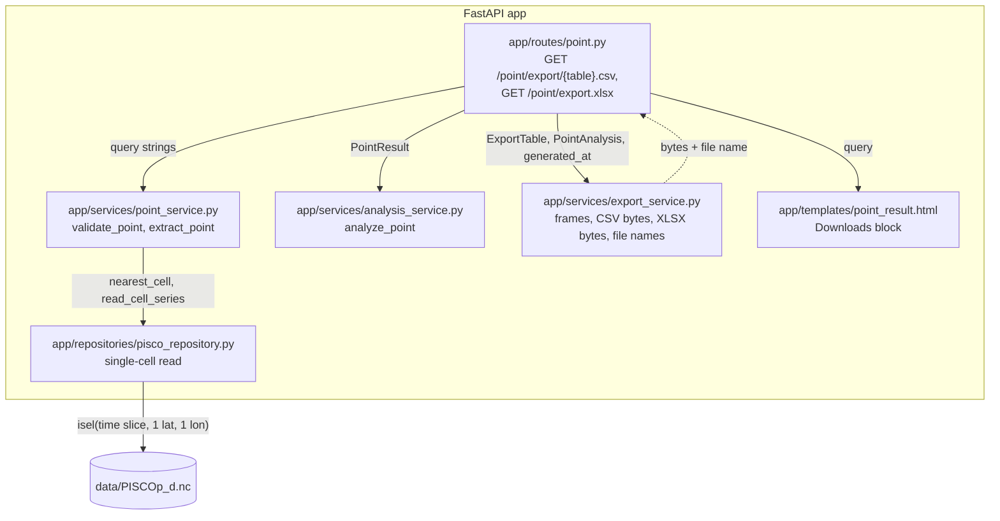

# Design

## Context

See `proposal.md` (Why) and the `data-export` spec. Follows ADR-0004 (layers), ADR-0005 (lazy
single-cell reads), ADR-0012 (completeness) and ADR-0013 (stateless GET URLs, whose follow-up
already names exports).

Current state (observed in the code):

- `GET /point/result` and `GET /point/chart/{kind}.png` (`app/routes/point.py`) both build a
  `PointForm` from raw query strings and call `extract_point(repo, validate_point(repo, form))`.
  The chart route maps `PointInputError` → 422 plain text, `NoDataError` and unavailable daily
  data → 404.
- `analyze_point(result)` (`app/services/analysis_service.py`) returns `PointAnalysis` with
  `annual: list[AnnualStat]` and `climatology: list[MonthlyClimate]`; `result.series` is a
  `pd.Series` (DatetimeIndex `date`, float64 converted from the file's float32, NaN = missing).
- `result.cell.lon/lat` are centers rounded to 4 decimals (`CellRef`).
- `result_query(form)` already builds the query without `page`.
- pandas and openpyxl are declared in `pyproject.toml`; openpyxl is not imported yet.

Observed float32 noise: a value stored as float32 0.1 becomes 0.10000000149011612 as float64,
which pandas writes verbatim. The reference maximum of 1998 (22.1680 mm in the real file) must
round-trip as `22.168`.

## Architecture

Components touched (C4 level 3):



The export service works only on `PointAnalysis`; it never touches the repository or xarray.
Omitted: chart service and unchanged pages.

## Goals / Non-Goals

**Goals:**
- One table builder per table, shared by CSV and XLSX, so both formats can never disagree.
- Byte-exact, deterministic CSV output that tests can compare line by line.

**Non-Goals:**
- Streaming or chunked responses (the largest file, 1981–2025 daily, is ~16 500 rows, ~300 KB).
- Styling the workbook beyond the date number format.

## Decisions

### D1. Contracts

Export service (`app/services/export_service.py`, no FastAPI, no xarray):
```python
class ExportTable(StrEnum):
    DAILY = "daily"; ANNUAL = "annual"; CLIMATOLOGY = "climatology"

COLUMNS: dict[ExportTable, list[str]]   # exact column order of the spec
DECIMALS = 4
CSV_MEDIA_TYPE = "text/csv; charset=utf-8"
XLSX_MEDIA_TYPE = "application/vnd.openxmlformats-officedocument.spreadsheetml.sheet"

def table_frame(table: ExportTable, analysis: PointAnalysis) -> pd.DataFrame
    # daily: date (datetime.date), precipitation_mm (float64)
    # annual: year, total_mm, max_24h_mm, valid_days, complete (bool)
    # climatology: month (1..12), mean_mm, sd_mm, n_years
    # None → NaN; float columns rounded to DECIMALS
def to_csv(frame: pd.DataFrame) -> bytes
def metadata_rows(analysis: PointAnalysis, generated_at: datetime) -> list[tuple[str, str | float | int]]
def to_xlsx(analysis: PointAnalysis, generated_at: datetime) -> bytes
def export_filename(result: PointResult, table: ExportTable | None) -> str
    # table None → .xlsx
```

Routes (`app/routes/point.py`):

| Method | Path | Query | Success | Errors |
|---|---|---|---|---|
| GET | `/point/export/{table}.csv` | `lon, lat, start_year, end_year` | 200 `text/csv; charset=utf-8`, `Content-Disposition: attachment; filename="…"` | unknown table 404 (before any read); `PointInputError` 422 plain text; `NoDataError` / daily unavailable 404 |
| GET | `/point/export.xlsx` | same | 200 XLSX media type, attachment | same as above |

The chart route's query handling (daily-availability check, validate, extract, error mapping)
moves to one private helper `_analysis_from_query(repo, lon, lat, start_year, end_year) ->
PointAnalysis`, which raises `HTTPException(404)` or a module-level `_InputRejected` carrying the
422 message, turned into `PlainTextResponse` by each route. The chart route keeps its behavior.
Route handlers pass `datetime.now(UTC)` as `generated_at`; tests call the service with a fixed
time.

Template: `point_result.html` gets a `<nav class="downloads" aria-label="Downloads">` under the
heading, outside the tabs, with four relative links `/point/export/…?{{ query }}` carrying the
`download` attribute, followed by a `<p class="note">` with the format note of the spec (CSV
for R and Python, XLSX for Excel with Spanish regional settings). `point.html` (form, errors,
no data) gets neither.

Rejected: a separate `app/routes/export.py` router — it would duplicate the query handling or
import private helpers across route modules; the point router already owns this query.

### D2. One frame per table, two writers

`table_frame` builds the frame from `PointAnalysis` once; `to_csv` and `to_xlsx` only serialize
it. Rejected: writing the XLSX with openpyxl cell by cell from the dataclasses, because the two
formats would then have two code paths for columns and rounding.

### D3. CSV serialization

`frame.to_csv(buffer, index=False, lineterminator="\n", na_rep="", encoding="utf-8")` on a
`StringIO`, then `.encode("utf-8")`:

- `lineterminator="\n"` is explicit: pandas defaults to `os.linesep`, i.e. `\r\n` on Windows.
- No BOM: `readr` and pandas do not need it, and the content is ASCII.
- `complete` is mapped to the strings `TRUE`/`FALSE` before writing (R's literals; pandas
  `read_csv` also parses them as booleans). pandas would write `True`/`False`.
- Dates are `datetime.date` objects, written as `YYYY-MM-DD`; `readr::read_csv` parses the
  column as `<date>`.
- No `float_format`: after `round(4)` the shortest `repr` is written (`22.168`, `1629.0`,
  `6.6577`), so values keep 4 decimals at most without padding zeros.

Rejected: `float_format="%.4f"`, because it pads (`0.0000`) and inflates the daily file; it would
also not be needed for the noise because rounding happens on the values.

### D4. Rounding

`round(DECIMALS)` on the float64 columns of every frame (daily values and aggregates), applied
in `table_frame` so CSV and XLSX share it. Aggregates are computed from unrounded values, as on
the result page, and rounded only for output. Rejected: rounding the series before analysis,
because it would change the page's statistics.

### D5. Workbook

`pd.ExcelWriter(BytesIO, engine="openpyxl", date_format="YYYY-MM-DD")`; sheets in order
`daily`, `annual`, `climatology`, `metadata`, each `to_excel(index=False)`. NaN cells are left
empty (pandas default), `complete` stays boolean, `date` is a real Excel date. `metadata` is a
two-column frame `field, value` from `metadata_rows`:

| field | value |
|---|---|
| `source` | `SENAMHI PISCOp v3.0 daily precipitation (PISCOp_d.nc), 0.1° grid` |
| `attribution` | `Servicio Nacional de Meteorología e Hidrología del Perú (SENAMHI). Data extracted with pisco-rain-extractor; cite SENAMHI PISCOp v3.0 when using these values.` |
| `requested_lon`, `requested_lat` | floats as requested |
| `cell_lon`, `cell_lat` | cell center |
| `distance_km` | 3 decimals, as on the page |
| `start_year`, `end_year` | requested years |
| `period_start`, `period_end` | ISO dates of the extracted series |
| `completeness_rule` | `A year or month is complete with at least 95% valid days (ADR-0012); only complete years enter the mean annual rainfall and only complete months the climatology.` |
| `generated_at_utc` | `generated_at.strftime("%Y-%m-%dT%H:%M:%SZ")` |

Rejected: openpyxl's `write_only` mode — not needed at ~16 500 rows, and pandas manages it.
Rejected: metadata first — users open the workbook for the data; the sheet name is explicit.

### D6. File names

`pisco_{lat}_{lon}_{start}-{end}_{table}.csv` with each coordinate formatted
`f"{value:.4f}".rstrip("0").rstrip(".")` (`-12.25`, `-76.15`), so names are stable for any input
point that selects the same cell. The workbook drops `_{table}` and uses `.xlsx`. The name holds
only digits, `-`, `.` and `_`, so `Content-Disposition` needs no quoting beyond `filename="…"`.
Rejected: the requested coordinates, because two inputs for one cell would give different names
for identical data.

### D7. Memory and reads

Each download performs exactly one single-cell `read_cell_series` (ADR-0005, ADR-0013). The
whole response is built in memory: at most ~16 500 daily rows, under 1 MB for the CSV and a few
MB transiently for openpyxl. Nothing is cached between requests.

### D8. ADR

The tabular export format (columns, rounding, empty missing values, `TRUE`/`FALSE`, ISO dates,
UTF-8 without BOM, file names) will be reused by basin exports. Recorded in
[ADR-0014](../../../adr/0014-define-the-tabular-export-format-for-csv-and-xlsx.md) (Accepted).

## Risks / Trade-offs

- [Rounding hides sub-0.0001 mm differences] → PISCOp values are reported at far coarser
  precision; the page already shows fewer decimals.
- [Excel on Windows opens a BOM-less CSV with the locale's separator (`;` in Spanish locales)]
  → the workbook is the Excel path; the CSV targets R and Python. A note next to the links says
  so (exact text in the `data-export` spec, "Format note next to the links").
- [CSVs carry no attribution] → the workbook's metadata sheet does; adding comment lines would
  break `read_csv` defaults (out of scope).
- [Excel row limit 1 048 576] → far above the 16 500 daily rows of the full period.
- [Floating rounding at exact halves (e.g. x.xxxx5)] → `round` uses banker's rounding on binary
  values; acceptable at 4 decimals and identical in both formats.
