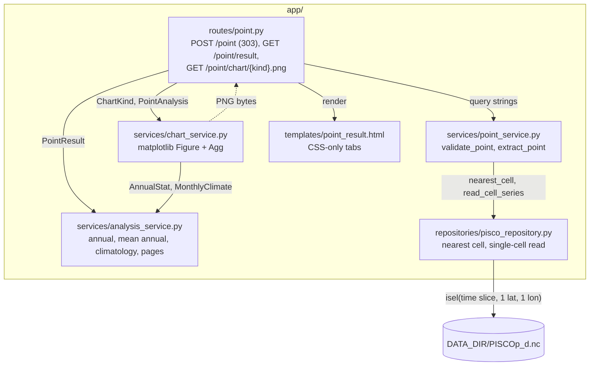

# Design

## Context

See `proposal.md` (Why) and the specs `rainfall-analysis` and `point-extraction`. Follows
ADR-0002 (server-rendered forms), ADR-0004 (layers), ADR-0005 (lazy reads), ADR-0006 (nearest
cell), ADR-0007 (calendar), ADR-0008 (climatology computed from the daily series), ADR-0011
(validity domain and tie rule), ADR-0012 (completeness) and ADR-0013 (stateless URLs).

Current state (observed in the code):

- `extract_point(repo, form)` validates (D2 of `add-point-extraction`), reads one cell and
  returns `PointResult` with `head`/`tail` previews and `series: pd.DataFrame`. `POST /point`
  renders it directly in `point.html`.
- `PiscoRepository.read_cell_series(cell, start, end)` returns a `pd.Series` (DatetimeIndex
  `date`, float mm, NaN = missing) with one `isel`. `metadata(DAILY).resolution_deg` is 0.1.
- matplotlib is already a dependency; it is not imported anywhere yet.

Facts checked on the real daily file (one cell only, before writing this plan):

- Reference point (-76.1390222, -12.2935861) → cell (-76.15, -12.25). Years 1981–2024: 16071
  days, 0 missing. Annual maxima 1981 14.7543, 1982 10.8256, 1983 18.9605, 1984 13.3684, 1985
  12.0172, 1997 19.4062, 1998 22.1680 mm: all seven within 0.001 mm of the reference values
  (largest difference 0.00047 mm). Every year has 365/366 valid days. Mean annual total 468.59 mm.
- A one-day shift of the series (±1) gives the same seven maxima, so these references confirm
  values and calendar length but **cannot detect a one-day calendar offset** (see Risks).
- Reading the full 1981–2025 period of one cell takes ~0.15 s cold and ~2 ms warm.
- **Calendar alignment evidence (2026-10-25, closes the gap above; ADR-0007 is not edited).**
  Daily values of cell (-76.15, -12.25), 1981–2025, re-dated by an offset of k days, summed per
  calendar month and compared with the same cell of `PISCOp_m.nc` (selected by its own
  coordinates; same center -76.15, -12.25). Common months 1981-02 to 2025-11 (538), no NaN:

  | Offset (days) | Mean abs. diff (mm) | Median (mm) | Max (mm) |
  |---|---|---|---|
  | −2 | 2.331 | 0.613 | 23.23 |
  | −1 | 1.248 | 0.458 | 14.12 |
  | **0** | **0.236** | **0.160** | **3.23** |
  | +1 | 1.284 | 0.437 | 21.09 |
  | +2 | 2.473 | 0.573 | 32.47 |

  Offset 0 gives the smallest difference by a factor of ~5, so the daily calendar starting on
  1981-01-01 is aligned with the monthly file. Offset 0 is not an exact match (max 3.23 mm): the
  monthly product is not exactly the sum of the daily one, so the check ranks offsets instead of
  requiring equality (D10).

## Architecture

Components touched (C4 level 3):



The analysis and chart services never touch xarray or the repository; they work on the
`pd.Series` inside `PointResult`. Omitted: the unchanged home and dataset pages.

## Goals / Non-Goals

**Goals:**
- Pure, unit-testable analysis functions with hand-computable synthetic inputs.
- Every result and chart URL is stateless and reproducible from its query string.

**Non-Goals:**
- Caching series or figures between requests; interactive charts; exports.

## Decisions

### D1. Contracts

Point service (`app/services/point_service.py`) — validation is split from reading:
```python
@dataclass(frozen=True)
class PointQuery:            # validated request
    lon: float; lat: float; start_year: int; end_year: int

def validate_point(repo: PiscoRepository, form: PointForm) -> PointQuery
    # D2 order and messages of add-point-extraction; reads no precipitation
def extract_point(repo: PiscoRepository, query: PointQuery) -> PointResult  # one read; NoDataError
def result_query(form: PointForm) -> str
    # urlencode({"lon", "lat", "start_year", "end_year"}) of the stripped form strings

@dataclass(frozen=True)
class PointResult:
    lon: float; lat: float; cell: CellRef; distance_km: float; resolution_deg: float
    start_year: int; end_year: int
    period_start: date; period_end: date; total_days: int; missing_days: int
    series: pd.Series        # DatetimeIndex "date", float mm, NaN = missing, as read
```
`head`, `tail`, `PREVIEW_ROWS` and the `DataFrame` field are removed (replaced by the Daily tab;
a later export change builds its own frame from `series`).

Analysis service (`app/services/analysis_service.py`, no FastAPI, no xarray):
```python
COMPLETENESS_PERCENT = 95
PAGE_SIZE = 365

@dataclass(frozen=True)
class AnnualStat:
    year: int; total_mm: float | None; max_24h_mm: float | None
    valid_days: int; calendar_days: int; complete: bool

@dataclass(frozen=True)
class MeanAnnual:
    mean_mm: float | None; complete_years: int

@dataclass(frozen=True)
class MonthlyClimate:
    month: int; mean_mm: float | None; std_mm: float | None; years: int

@dataclass(frozen=True)
class DailyPage:
    page: int; page_count: int; rows: list[tuple[str, float | None]]

@dataclass(frozen=True)
class PointAnalysis:
    result: PointResult; annual: list[AnnualStat]
    mean_annual: MeanAnnual; climatology: list[MonthlyClimate]

def is_complete(valid_days: int, calendar_days: int) -> bool
def annual_stats(series: pd.Series, start_year: int, end_year: int) -> list[AnnualStat]
def mean_annual_rainfall(annual: list[AnnualStat]) -> MeanAnnual
def monthly_climatology(series: pd.Series, start_year: int, end_year: int) -> list[MonthlyClimate]
def daily_page(series: pd.Series, page_text: str) -> DailyPage
def analyze_point(result: PointResult) -> PointAnalysis
```

Chart service (`app/services/chart_service.py`):
```python
class ChartKind(StrEnum):
    DAILY = "daily"; ANNUAL_TOTALS = "annual-totals"; ANNUAL_MAXIMA = "annual-maxima"
    CLIMATOLOGY = "climatology"; LOCATION = "location"

def build_figure(kind: ChartKind, analysis: PointAnalysis) -> Figure
def render_png(kind: ChartKind, analysis: PointAnalysis) -> bytes
```

Routes (`app/routes/point.py`); every query parameter is `Query("")` (raw string) so invalid
text reaches the service and yields the spec's messages:

| Method | Path | Inputs | Response | Status |
|---|---|---|---|---|
| GET | `/point` | – | `point.html` (unchanged) | 200 |
| POST | `/point` | form fields as today, `action` | `convert`: `point.html`; `extract`: redirect to `/point/result?{result_query}` | 200 / 303; 422 on `PointInputError` |
| GET | `/point/result` | `lon`, `lat`, `start_year`, `end_year`, `page` | `point_result.html` | 200; 422 → `point.html` with error and values; `NoDataError` → `point.html` 200; daily unavailable → `point.html` (`available=False`) 200 |
| GET | `/point/chart/{kind}.png` | same as result, no `page` | `Response(png, media_type="image/png")` | 200; 404 unknown kind (checked before any read) or `NoDataError`; 422 plain text on `PointInputError`; 404 when daily unavailable |

### D2. Completeness (ADR-0012)
`is_complete(valid, days) := valid * 100 >= COMPLETENESS_PERCENT * days`, in integers, so 347/365
and 348/366 are decided exactly (no float edge). `calendar_days` is the length of the calendar
year (365/366) or month, **not** the number of rows read: `annual_stats` and
`monthly_climatology` reindex the series to `pd.date_range(f"{start}-01-01", f"{end}-12-31")`,
so days absent from the file (a 2025 cut at 06-30) count as missing. The same rule gates
`mean_annual_rainfall` (complete years only) and climatology (complete months only).
Rejected: counting only rows present – a cut year would look complete. Rejected: treating
missing as 0 mm – biases totals down silently. Rejected: no threshold – incomplete totals
enter the mean. It affects every future aggregate (exports, basins) → recorded as ADR-0012: Use a 95%
valid-day threshold for complete years and months.

### D3. Statistics
- Annual: `groupby(index.year)`; `total = sum(min_count=1)` (None when no valid day), `max`
  (None when none), `valid = count()`. Full precision is kept; rounding happens only in the
  template (total 1 decimal, max 3 decimals so values compare with the reference cases, daily
  2 decimals, climatology and mean annual 1 decimal).
- Max 24 h is the largest single PISCOp daily value (one time step), not a rolling 24 h window.
- Climatology: monthly totals per (year, month) with `sum(min_count=1)`, kept only if the month
  is complete; per calendar month `mean` and `std(ddof=1)` (sample); `std = None` when fewer than
  2 years, `mean = None` with 0 years. Rejected: population std (ddof=0) – underestimates
  spread for short periods. Rejected: averaging daily values ×30 – ignores month lengths.
- Rejected: reading `PISCOp_clim2.nc` – ADR-0008.

### D4. Pagination
`daily_page` parses `page_text` with `int()`; non-integer → 1; then clamps to
`1..ceil(n / PAGE_SIZE)`. Rows come from the series as read (missing → None). Links keep the
result query and append `&page=N#daily`. Rejected: 404 on out-of-range pages – a stale bookmark
after changing years would break; clamping is harmless.

### D5. Stateless result and chart URLs (ADR-0013)
`POST /point` only validates (`validate_point`, no read) and redirects 303 to a GET URL that
fully describes the request. `GET /point/result` and each `GET /point/chart/{kind}.png` call
`validate_point` → `extract_point` → `analyze_point` independently. Rejected: inline base64
images in the POST response – pagination would need re-posting the form and URLs could not be
bookmarked. Rejected: an in-memory series cache keyed by id – state, expiry and memory growth for
a 2 ms read. It shapes every future result page (exports will reuse the same query) → recorded as
ADR-0013: Serve point results and charts from stateless GET URLs that re-read the cell.

### D6. Memory strategy
Each request performs exactly one single-cell read through `read_cell_series` (one `isel`,
≤ 16436 float values ≈ 130 KB); nothing is cached in the app. A full result view is at most
6 reads (page + 5 charts), and charts in hidden tabs use `loading="lazy"` so browsers fetch them
only when shown. Concurrent reads are serialized by xarray's netCDF4 lock. Figures are closed
after rendering (`Figure` objects are not registered in pyplot, so they are freed with the
request).

### D7. Charts
matplotlib object-oriented API only: `Figure(figsize=(8, 3.5), dpi=100)` and
`fig.savefig(BytesIO(), format="png")`, which uses the Agg canvas. `pyplot` is never imported,
so there is no global figure registry or GUI backend. A module-level `threading.Lock` wraps
build + render because matplotlib does not guarantee thread safety and sync routes run in
FastAPI's thread pool. Rejected: `pyplot` with `matplotlib.use("Agg")` – global state shared
across threads.
- Daily: line of daily values (NaN gaps), x = date, y = "Precipitation (mm)".
- Annual totals / maxima: one bar per year; incomplete years in a lighter color with hatch and
  a legend with "Complete year" / "Incomplete year" (the incomplete entry only when present).
- Climatology: bars only for months with a mean (missing months leave a gap, x ticks for all 12),
  `yerr = std` where available, labels Jan–Dec.
- Location: cell `Rectangle` (center ± `resolution_deg / 2`), markers for cell center and
  requested point, legend, axes "Longitude (°)" / "Latitude (°)", aspect `1 / cos(lat)` so a
  degree looks the same on both axes, title with the distance.
- Colors follow the dataviz skill palette (checked during apply). Tests inspect the `Figure`
  from `build_figure` (patch count, legend texts, error bar containers, axis labels), not pixels.

### D8. CSS-only tabs
`point_result.html`: `<nav class="tabs">` with `<a href="#summary">`…`<a href="#location">`, then
one `<section class="tab" id="…">` per tab. CSS: `.tab { display: none }`,
`.tab:target { display: block }`, `.tab-panels:not(:has(.tab:target)) #summary { display: block }`,
active link styled with `.result:has(#daily:target) a[href="#daily"]`. Fallback:
`@supports not selector(:has(*)) { .tab { display: block } }` shows every section stacked.
Rejected: radio-button hack – the selected tab is lost when a pagination link reloads the page
(`#daily` in the URL keeps it with `:target`). Rejected: JavaScript – forbidden by
`config.yaml`. Rejected: one page per tab – more URLs for the same data. The nav also links back
to `/point`. No ADR: presentation detail local to one template.

### D9. Test strategy
- `tests/test_analysis_service.py`: pure `pd.Series` built in the test (no NetCDF): one 50 mm
  day, the 95% thresholds (347/365, 346/365, 348/366, 347/366), cut year, all-missing year, mean
  annual 500.0 from 2 years, climatology 120.0 ± 28.3, excluded month, single year, pagination
  1826 rows → 6 pages and clamping.
- `tests/test_chart_service.py`: `build_figure` assertions; `render_png` starts with
  `b"\x89PNG\r\n\x1a\n"`; module does not import `matplotlib.pyplot` nor fastapi.
- `tests/test_point_pages.py`: the reference fixture (`(day % 7) * 1.5` mm, NaN on
  1981-01-03 and 1981-06-01) gives 1981 total 1629.0, max 9.000, 363 valid days; 1984 total
  1648.5, 366 days; 1981–1985 mean annual 1640.7 from 5 years; January climatology 137.7 ± 6.7.
- Real-data reference maxima and calendar alignment are checked against `data/` only in the
  integration group (tasks 6.2, 6.3): tests never use `data/`.

### D10. Calendar alignment check (diagnostic, not part of the analysis)
A reproducible version of the evidence in Context, so a new PISCOp release or a changed start
date in `app/config.py` can be re-checked.

Repository (`app/repositories/pisco_repository.py`):
```python
def nearest_cell(self, lon: float, lat: float, kind: DatasetKind = DatasetKind.DAILY) -> CellRef
    # same ADR-0011 rule on the coordinates of `kind` (DAILY or MONTHLY)
def read_monthly_cell_series(self, cell: CellRef) -> pd.Series
    # one isel of the full monthly period for one cell; index = monthly calendar (ADR-0007)
```
Each file's cell is located by **its own coordinates** (ADR-0008: no index reuse across grids).

Service (`app/services/calendar_check.py`, pure pandas):
```python
@dataclass(frozen=True)
class OffsetScore:
    offset_days: int; months: int; mean_abs_diff_mm: float; max_abs_diff_mm: float

def alignment_scores(
    daily: pd.Series, monthly: pd.Series, offsets: range = range(-2, 3)
) -> list[OffsetScore]
def best_offset(scores: list[OffsetScore]) -> int   # smallest mean_abs_diff_mm
```
Each offset re-dates the daily index by `k` days, sums per month (`min_count=1`) and is compared on
the **same** set of months for every offset: months of the monthly calendar strictly inside the
daily period (first and last daily month dropped, since a shift cuts them) and without NaN.

Script (`scripts/check_calendar_alignment.py`): `uv run python scripts/check_calendar_alignment.py
[--lon -76.15 --lat -12.25]` opens the repository with the default settings, prints the table
above and exits 1 when `best_offset != 0`. Memory: two single-cell reads (16436 + 540 values).
Rejected: a pytest test on `data/` – tests must never use SENAMHI files. Rejected: requiring
equality per month – the products differ by up to 3.2 mm at offset 0. Rejected: reusing the daily
cell index on the monthly file – breaks if the grids diverge (ADR-0008).

## Risks / Trade-offs

- [The seven reference maxima cannot detect a one-day calendar offset (checked: a ±1 shift
  gives the same values)] → Closed by the daily-vs-monthly alignment evidence (Context) and the
  reproducible check of D10. Residual: it detects offsets relative to the monthly file, not a
  shift applied equally to both files (as ADR-0007 already notes).
- [`:has()` is missing in old browsers] → `@supports` fallback shows all sections; no content is lost.
- [Up to 6 reads per page view] → each is a one-cell read of ~2 ms warm; lazy images avoid
  reads for unopened tabs.
- [matplotlib rendering cost ~100 ms per chart with a global lock] → acceptable for a
  single-user tool; revisit with caching only if measured slow.
- [**BREAKING**: `POST /point` no longer returns the result HTML] → bookmarks and the form keep
  working; only clients that scraped the POST body are affected.

## Migration Plan

No data migration. Existing tests that assert the result in the `POST /point` body move to the
redirect + `GET /point/result`. Rollback = revert the change commits.
