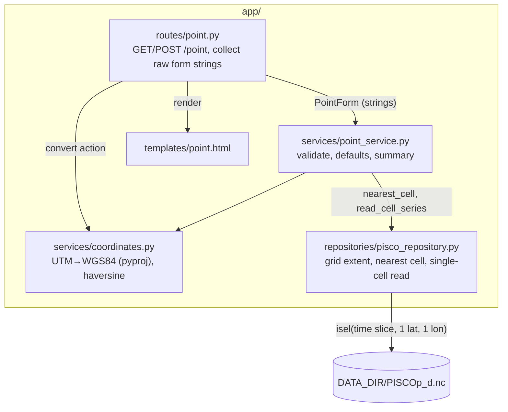

# Design

## Context

See `proposal.md` (Why) and the specs `point-extraction` and `web-shell`. Follows ADR-0002
(server-rendered forms), ADR-0004 (layers), ADR-0005 (lazy reads), ADR-0006 (nearest cell),
ADR-0007 (calendar), ADR-0008 (climatology catalog-only), ADR-0010 (latitude handling) and
ADR-0011 (validity domain and tie rule).

Facts checked on the real daily file (metadata and one cell only):

- `precipitation` is float32 with `_FillValue = -1.175494e+38`; xarray's default masking turns
  it into NaN, so missing values arrive as NaN. Chunks are (2740, 35, 29).
- Reference point (-76.1390222, -12.2935861) → nearest cell (-76.15, -12.25) at index
  (latitude 142, longitude 52); haversine distance 4.991 km (mean Earth radius 6371.0088 km).
  The stored center is -12.250000000000004, so displayed coordinates are rounded.
- Reference UTM (376135.41, 8640719.67, zone 18 South, EPSG:32718) → (-76.139022, -12.293586).
- An ocean cell (-80.05, -15.05) is all NaN; reading 730 days of one cell performs exactly one
  backend read of shape (730,) (`xarray.backends.netCDF4_.NetCDF4ArrayWrapper._getitem`).
- Existing repository API: `PiscoRepository.dataset(kind)`, `time_index(kind)`,
  `metadata(kind)`; routes get the repository through `RepositoryDep`.

## Architecture

Components touched (C4 level 3):



Only the repository touches xarray; services work with plain values and pandas.

## Goals / Non-Goals

**Goals:**
- A repository read path that later changes reuse (`add-point-analysis` needs the same series).
- Every spec scenario testable with synthetic fixtures; the reference cases reproduced exactly.

**Non-Goals:**
- Statistics, charts, exports, caching of extracted series, async reads.

## Decisions

### D1. Contracts

Repository (`app/repositories/pisco_repository.py`), daily file only:
```python
@dataclass(frozen=True)
class GridExtent:            # outer cell edges = centers ± resolution / 2
    lon_min: float; lon_max: float; lat_min: float; lat_max: float

@dataclass(frozen=True)
class CellRef:
    lat_index: int; lon_index: int
    lon: float; lat: float   # cell center, rounded to 4 decimals

class PiscoRepository:
    def grid_extent(self) -> GridExtent | None: ...            # None if daily unavailable
    def nearest_cell(self, lon: float, lat: float) -> CellRef: ...
    def read_cell_series(self, cell: CellRef, start: date, end: date) -> pd.Series: ...
        # index: DatetimeIndex "date"; values: float mm, NaN = missing
```

Coordinates service (`app/services/coordinates.py`):
```python
class CoordinateError(ValueError): ...
def utm_to_wgs84(easting: float, northing: float, zone: int, hemisphere: str) -> tuple[float, float]
def haversine_km(lon1: float, lat1: float, lon2: float, lat2: float) -> float
```

Point service (`app/services/point_service.py`):
```python
@dataclass(frozen=True)
class PointForm:   # raw strings exactly as posted
    lon: str; lat: str; start_year: str; end_year: str
    easting: str; northing: str; zone: str; hemisphere: str

class PointInputError(ValueError): ...      # message shown to the user
class NoDataError(ValueError): ...          # "No data available for this location"

@dataclass(frozen=True)
class PointResult:
    lon: float; lat: float; cell: CellRef; distance_km: float
    period_start: date; period_end: date; total_days: int; missing_days: int
    head: list[tuple[str, float | None]]; tail: list[tuple[str, float | None]]
    series: pd.DataFrame                    # columns: date, precipitation_mm

def year_defaults(repo: PiscoRepository) -> tuple[int, int] | None
def convert_utm(form: PointForm) -> tuple[float, float]           # raises PointInputError
def extract_point(repo: PiscoRepository, form: PointForm) -> PointResult
```

Routes (`app/routes/point.py`):

| Method | Path | Form fields | Template | Status |
|---|---|---|---|---|
| GET | `/point` | – | `point.html` (`active="point"`, defaults) | 200 |
| POST | `/point` | `lon`, `lat`, `start_year`, `end_year`, `easting`, `northing`, `zone`, `hemisphere`, `action` (`extract` \| `convert`) | `point.html` with result, converted values or error | 200; 422 on `PointInputError` |

All fields are received as optional strings (`Form("")`) so invalid text reaches the service and
produces the spec's messages instead of FastAPI's generic 422 JSON. `NoDataError` renders 200
with the message (the request was valid). The router is included in `app/main.py`.

### D2. Validation order and messages
`extract_point` validates in this order and stops at the first error, before any data read:
1. numbers: "Longitude must be a number", "Latitude must be a number", "Start year must be an
   integer", "End year must be an integer";
2. extent: "The point is outside the PISCOp grid (longitude -81.4 to -64.0, latitude -19.0 to
   2.0)" with values from `grid_extent()`;
3. years: "Start year must not be later than end year", then "Years must be between {first} and
   {last}" where first/last are the first and last calendar years present in the daily index.
UTM (`convert_utm`): "Easting must be a number", "Northing must be a number", "UTM zone must be
17, 18 or 19", "Hemisphere must be North or South". Longitude/latitude are kept unchanged on error.

### D3. Grid extent and nearest cell
`grid_extent` = min/max of the daily centers ± `resolution_deg / 2`, rounded to 4 decimals
(bounds via min/max per ADR-0010, so order does not matter). Inclusive comparison, so a point on
the outer edge is accepted.

`nearest_cell` applies, on latitude and longitude separately, a helper
`_nearest_index(coord: np.ndarray, value: float, tol: float = LAT_TOLERANCE_DEG) -> int`:
`d = abs(coord.astype(float) - value)`; candidates are the indices with `d <= d.min() + tol`;
among them the one with the **largest coordinate** wins (north for latitude, east for longitude).
This is the tie rule of ADR-0011; it works on descending or ascending axes and on float32 or
float64 coordinates (float32 noise at a tie is 3.8e-7°, below the 1e-6° tolerance). Point
extraction selects one cell, never a latitude range, so `lat_slice` is not involved.
Rejected: `pd.Index.get_indexer(method="nearest")` / xarray `method="nearest"` – picks a tied
cell by float noise, so the result could change between float32 and float64 files. Rejected:
snapping out-of-grid points to the border cell – ADR-0006 rejects it. Rejected: accepting only
points between the outermost centers – rejects valid points in the outer half of border cells.
See ADR-0011: Define the point validity domain as the grid cell edges.

### D4. Period from the calendar (ADR-0007)
`read_cell_series` takes dates, not indices. It computes positions on
`time_index(DAILY)`: `positions = np.flatnonzero((idx >= start) & (idx <= end))`, then
`isel({time: slice(positions[0], positions[-1] + 1), lat: i, lon: j})`. Raw `Z1` values are never
read or compared. The service maps years to `date(start_year, 1, 1)`..`date(end_year, 12, 31)`.
`year_defaults` returns the first calendar year and the last year whose 31 December is in the index.
Rejected: `sel` on `Z1` labels – they are integers, not dates.

### D5. Memory strategy
One `isel` with integer positions on all three dimensions, then `.values`: a single backend read
of `n_days` values (one cell). The dataset handle stays lazy; nothing is cached. Missing values
are NaN from the file's `_FillValue`. The memory test wraps
`NetCDF4ArrayWrapper._getitem` with a spy (monkeypatch) and asserts every precipitation read
has at most one element along latitude and longitude, plus `not variable._in_memory`.

Because `_getitem` is private xarray API, the test must never pass silently when it changes:
- if `xarray.backends.netCDF4_.NetCDF4ArrayWrapper` has no `_getitem` attribute, the test calls
  `pytest.fail("xarray internals changed; update the read spy")` (a failure, never a skip);
- after the extraction it asserts the spy recorded at least one precipitation read, with the
  same message, so a hook that still exists but is no longer called also fails.
Rejected: `ds.load()` or reading the whole cell column for all years then filtering – needless I/O.

### D6. Distance
Haversine with the mean Earth radius 6371.0088 km (IUGG), rounded to 3 decimals for display.
Rejected: pyproj `Geod` – more precise (ellipsoid) but the difference at < 8 km is below 0.02 km
and haversine needs no extra object; the value is informative, not used in computations.

### D7. UTM conversion
`pyproj.Transformer.from_crs(f"EPSG:{327 if South else 326}{zone:02d}", "EPSG:4326",
always_xy=True)`, created per call (cheap at this volume). Output rounded to 6 decimals
(~0.1 m). The "Convert" action never reads precipitation.

### D8. Templates and navigation
`point.html`: one `<form method="post" action="/point">` with two fieldsets (WGS84, optional
UTM) and two submit buttons `name="action"` `value="convert"` / `value="extract"`; errors in
`<div class="error" role="alert">`; result in a `<section>` with a summary `<dl>` and two small
tables (first 5, last 5 rows; NaN shown as "missing"). If the daily file is unavailable the page
shows "Daily data is not available" with a link to `/dataset` and no form. `base.html` nav order:
Home, Point, Dataset. No JavaScript.

### D9. Test fixtures
`write_pisco_file` gains `lat_start`, `values` (an optional callable or array to fill the
precipitation grid) and `coord_dtype` (default float32) so tests can build: a grid around the
reference point (latitude -12.05 to -12.45 descending, longitude -76.35 to -76.05, so
-76.15/-12.25 is a center and -12.30 / -76.10 are ties), the same grid in float64, a cell with
all NaN, and a cell with NaN on chosen days. Default output stays identical (zeros, float32).

## Risks / Trade-offs

- [Spying on a private xarray method may break on upgrade] → The memory test fails with
  "xarray internals changed; update the read spy" when `_getitem` is missing or records no read
  (D5); it is never skipped, so an xarray upgrade cannot silently disable the memory guarantee.
  Only that test uses the hook, so the fix is local.
- [Ties between two equidistant cells] → Explicit rule of ADR-0011 (north/east wins within 1e-6°),
  tested on float32 and float64 grids.
- [Reading 45 years of one cell crosses ~6 time chunks] → ~16k values (64 KB); acceptable.
- [422 status for form errors] → Browsers render it normally; tests assert it.

## Migration Plan

Additive; no data or config migration. Rollback = revert the change's commits.
