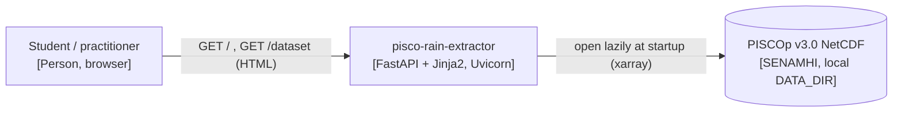
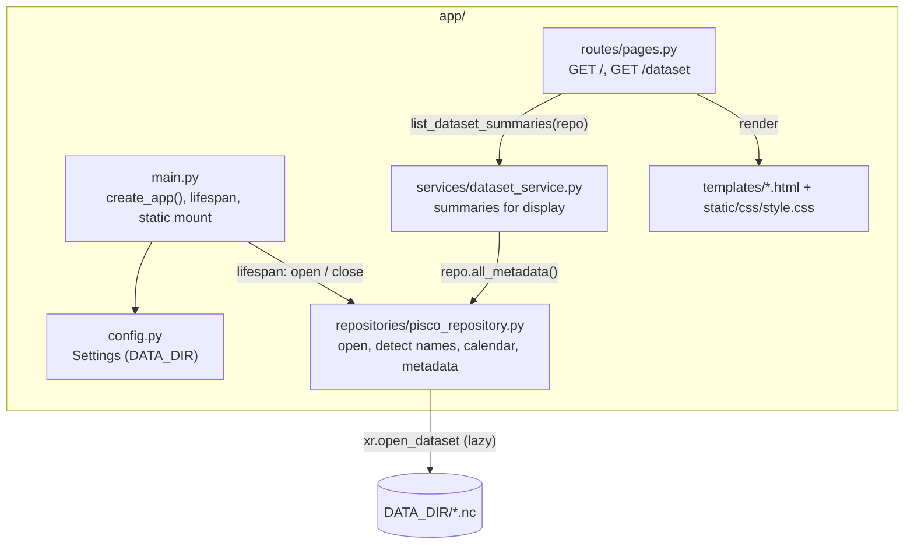

# Design

## Context

See `proposal.md` (Why) and the specs `dataset-catalog` and `web-shell` for behavior.
This is the first change: there is no code yet. It follows the accepted ADRs:
ADR-0002 (FastAPI + Jinja2), ADR-0003 (uv), ADR-0004 (layers), ADR-0005 (lazy xarray reads).

Facts observed in the real files (inspected lazily, metadata only):

| File | Variable | Dims (size) | Lat | Lon | Units |
|---|---|---|---|---|---|
| `PISCOp_d.nc` | `precipitation` | `Z1` 16436, `latitude` 210, `longitude` 174 | 1.95 → -18.95 (descending) | -81.35 → -64.05 | `mm` |
| `PISCOp_m.nc` | `precipitation` | `Z1` 540, 210, 174 | same | same | `mm` |
| `PISCOp_clim2.nc` | `PISCOp_clim2` | `Z1` 12, 210, 180 | same | -81.95 → -64.05 | none |

`Z1` is an integer index (1..N, `units: unknown`), not a date. 16436 days = 1981-01-01 to
2025-12-31; 540 months = 1981-01 to 2025-12. Chunking of the daily file is
(2740, 35, 29), so a single-cell time series read touches about 6 time chunks.

## Architecture

System context (C4 level 1):



Components (C4 level 3):



Only the repository imports xarray/netCDF4. Services never import FastAPI. Routes never
touch xarray.

## Goals / Non-Goals

**Goals:**
- A repository API that later changes (point and basin extraction) reuse unchanged:
  handles with detected names and a calendar index.
- Tests that never need the real SENAMHI files.

**Non-Goals:**
- Reading precipitation values (no extraction API yet beyond the handle).
- Caching, dask, async file access.

## Decisions

### D1. Project layout and tooling
`uv init --app --python 3.12`, then the `uv add` commands in `tasks.md`. The full stack from
`openspec/config.yaml` is added now (pyproj, geopandas, shapely, matplotlib, openpyxl are
unused in this change but fixed by the stack; adding them once avoids lock churn later).
Dev group: pytest, httpx, ruff. The root `main.py` and the `hello` stub created by
`uv init` are removed; the app entry point is `app.main:app`.
Rejected: adding dependencies only when first used – the stack is fixed and agreed;
the cost is a larger initial environment.

### D2. Contracts

Settings (`app/config.py`):
```python
class Settings(BaseSettings):
    data_dir: Path = Path("data")          # env DATA_DIR
    model_config = SettingsConfigDict(env_file=".env", extra="ignore")
def get_settings() -> Settings: ...        # lru_cache
```

Repository (`app/repositories/pisco_repository.py`):
```python
class DatasetKind(StrEnum): DAILY = "daily"; MONTHLY = "monthly"; CLIMATOLOGY = "climatology"

FILES: dict[DatasetKind, str] = {DAILY: "PISCOp_d.nc", MONTHLY: "PISCOp_m.nc",
                                 CLIMATOLOGY: "PISCOp_clim2.nc"}

@dataclass(frozen=True)
class VariableInfo: name: str; units: str | None

@dataclass(frozen=True)
class DatasetMetadata:
    kind: DatasetKind; filename: str; available: bool; reason: str | None
    variable: str | None; lat_name: str | None; lon_name: str | None; time_name: str | None
    variables: list[VariableInfo]
    n_time: int; n_lat: int; n_lon: int
    lat_min: float | None; lat_max: float | None; lon_min: float | None; lon_max: float | None
    resolution_deg: float | None
    time_start: str | None; time_end: str | None    # ISO date, or "1"/"12" for climatology

class PiscoRepository:
    @classmethod
    def open(cls, data_dir: Path) -> "PiscoRepository": ...   # never raises for bad files
    def metadata(self, kind: DatasetKind) -> DatasetMetadata: ...
    def all_metadata(self) -> list[DatasetMetadata]: ...      # order: daily, monthly, clim
    def dataset(self, kind: DatasetKind) -> xr.Dataset | None: ...  # lazy handle, for later changes
    def time_index(self, kind: DatasetKind) -> pd.Index | None: ...
    def close(self) -> None: ...
```
Helper functions (module level, pure, unit-tested): `detect_names(ds) -> DetectedNames`
and `build_time_index(kind, n) -> pd.Index`.

Service (`app/services/dataset_service.py`):
```python
@dataclass(frozen=True)
class DatasetSummary:
    filename: str; kind: str; available: bool; warning: str | None
    variables: list[tuple[str, str]]   # (name, units or "not specified")
    grid: str | None                   # "210 x 174"
    lat_range: str | None; lon_range: str | None; resolution: str | None   # "0.1°"
    period: str | None                 # "1981-01-01 to 2025-12-31" / "months 1 to 12"
def list_dataset_summaries(repo: PiscoRepository) -> list[DatasetSummary]: ...
```

Routes (`app/routes/pages.py`, `APIRouter`):

| Method | Path | Template | Context | Status |
|---|---|---|---|---|
| GET | `/` | `home.html` | `active="home"` | 200 |
| GET | `/dataset` | `dataset.html` | `summaries`, `active="dataset"` | 200 (also with missing files) |
| GET | `/static/...` | – | `StaticFiles` mount | 200 / 404 |

No form fields in this change. The repository is read from `request.app.state.repository`
through a dependency `get_repository(request: Request) -> PiscoRepository`.

App (`app/main.py`): `create_app(settings: Settings | None = None) -> FastAPI`; the lifespan
calls `PiscoRepository.open(settings.data_dir)`, stores it in `app.state.repository`, and
calls `close()` on shutdown. Module-level `app = create_app()`.

### D3. Name detection
- Latitude: a dimension named `lat`/`latitude`/`y` (case-insensitive), or a coordinate with
  `units` `degrees_north` / `standard_name` `latitude`. Longitude: same with `lon`/`longitude`/`x`
  and `degrees_east`.
- Precipitation variable: data variables that have both the lat and lon dims plus exactly one
  other dim; if several, prefer `units == "mm"`, then a name containing `prec`/`pisco`.
  Scalar variables such as `crs` are ignored.
- Time: the remaining dim of the precipitation variable.
- Failure → dataset unavailable, reason "no precipitation variable found" (or
  "latitude/longitude coordinates not found").
Rejected: hardcoding `precipitation`/`Z1` – the climatology already uses `PISCOp_clim2`, and
the config forbids fixed names.

### D4. Calendar from the integer index – **Requires ADR** (ADR-0007, Proposed)
Daily: `pd.date_range("1981-01-01", periods=n, freq="D")`; monthly:
`pd.date_range("1981-01-01", periods=n, freq="MS")`; climatology: `pd.RangeIndex(1, 13)`
named `month`, and n must be 12. If the time coordinate already decodes to datetimes
(a future dataset version), those dates are used instead. The start date is a module
constant tied to PISCOp v3.0. Dates are kept as a separate index in the repository, not
assigned into the dataset, so the handle stays untouched.
Rejected: reading dates from `Z1` attributes – there are none (`units: unknown`).
Rejected: asking the user for the start date – error-prone and not a user concern.

### D5. Memory strategy
- `xr.open_dataset(path, engine="netcdf4", decode_times=False, cache=False)` – lazy; no
  precipitation values are read.
- Only the 1-D coordinates (≤ 16436 values) are read, for bounds, resolution and length.
- Resolution = median of `abs(diff(lat))`, rounded to 4 decimals.
- Each file is opened once at startup and closed on shutdown (Windows keeps file locks).
- Tests assert that the precipitation variable is not in memory after `open`
  (`not ds[var].variable._in_memory`).
Rejected: `chunks={}`/dask – adds a dependency with no benefit for single-cell reads.

### D6. Errors per file
`PiscoRepository.open` wraps each file independently: missing → reason
`"file not found: <name>"`; `OSError`/`ValueError` while opening → `"could not be read as NetCDF"`;
detection or calendar failures → their own reason. The app always starts.

### D7. Templates and CSS
`base.html` (header, `<nav>` with `aria-current="page"` on the active link, footer crediting
SENAMHI with a plain `<a>` to the figshare page), `home.html`, `dataset.html` (one
`<section>` per file; unavailable files show `<div class="warning" role="alert">` with the reason
and a mention of `data/README.md`). One stylesheet `app/static/css/style.css`. No `<script>`.

### D8. Tests
`tests/conftest.py` builds synthetic NetCDF files with the PISCOp layout in `tmp_path`
(5 lat x 4 lon, descending latitudes, `Z1` integer index; daily with 16436 steps ≈ 1.3 MB,
monthly 540, climatology 12 with variable `PISCOp_clim2` and no units) and exposes:
`data_dir` (all three files), a factory for custom/corrupt files, and `client`
(`TestClient(create_app(Settings(data_dir=...)))` used as a context manager so the lifespan runs).
ruff in `pyproject.toml`: `line-length = 100`, `target-version = "py312"`,
`select = ["E", "F", "I", "UP", "B", "SIM"]`. pytest: `testpaths = ["tests"]`.

## Risks / Trade-offs

- [The 1981-01-01 start is an assumption about PISCOp v3.0] → It matches the exact day and
  month counts and `readme.txt`; it is recorded in ADR-0007 and checked by length.
- [Climatology grid has 180 longitudes, daily has 174] → Metadata is per file; later changes
  must not assume the grids are identical.
- [Descending latitude] → Bounds use min/max, never first/last.
- [File locks on Windows during tests] → Repository `close()` in lifespan shutdown; fixtures
  use the client as a context manager.
- [Large initial dependency set (geopandas)] → Accepted by D1; uv lock keeps it reproducible.

## Migration Plan

Not applicable (first change). Rollback = revert the change's commits.
