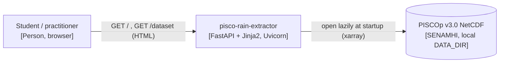
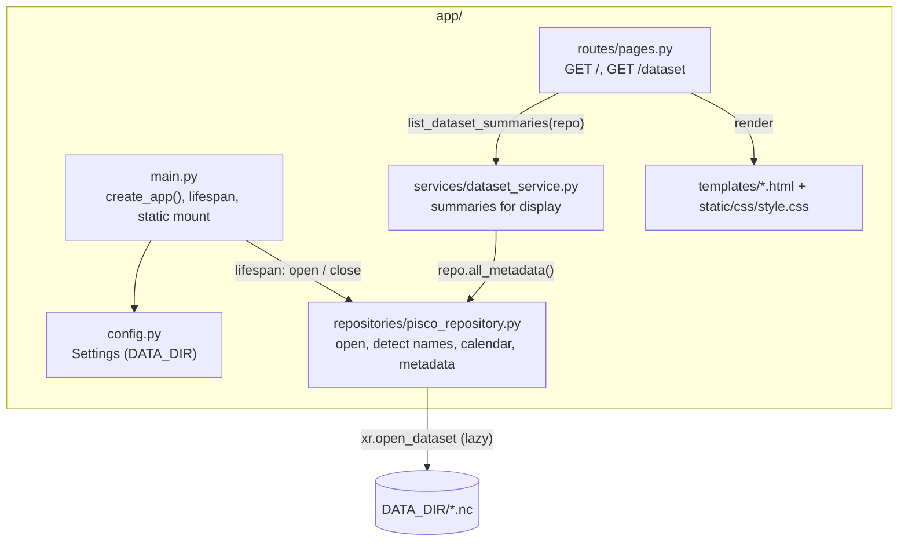

# Design

## Context

See `proposal.md` (Why) and the specs `dataset-catalog` and `web-shell` for behavior.
This is the first change: there is no code yet. It follows the accepted ADRs:
ADR-0002 (FastAPI + Jinja2), ADR-0003 (uv), ADR-0004 (layers), ADR-0005 (lazy xarray reads),
ADR-0007 (calendar from the time index).

Facts observed in the real files (inspected lazily, metadata only):

| File | Variable | Dims (size) | Lat | Lon | Units |
|---|---|---|---|---|---|
| `PISCOp_d.nc` | `precipitation` | `Z1` 16436, `latitude` 210, `longitude` 174 | 1.95 → -18.95 (descending) | -81.35 → -64.05 | `mm` |
| `PISCOp_m.nc` | `precipitation` | `Z1` 540, 210, 174 | same | same | `mm` |
| `PISCOp_clim2.nc` | `PISCOp_clim2` | `Z1` 12, 210, 180 | same | -81.95 → -64.05 | none (catalog-only, D11) |

Coordinates are float64 in the real files; the design tolerates float32 (D10).

`Z1` is an integer index (1..N, `units: unknown`), not a date. 16436 days = 1981-01-01 to
2025-12-31; 540 months = 1981-01 to 2025-12. Chunking of the daily file is
(2740, 35, 29), so a single-cell time series read touches about 6 time chunks.

## Architecture

System context (C4 level 1):



Components (C4 level 3):



Only the repository imports xarray/netCDF4. Services never import FastAPI. Routes never
touch xarray.

## Goals / Non-Goals

**Goals:**
- A repository API that later changes (point and basin extraction) reuse unchanged:
  handles with detected names and a calendar index.
- Tests that never need the real SENAMHI files.

**Non-Goals:**
- Reading precipitation values (no extraction API yet beyond the handle).
- Caching, dask, async file access.

## Decisions

### D1. Project layout and tooling
`uv init --app --python 3.12`, then the `uv add` commands in `tasks.md`. The full stack from
`openspec/config.yaml` is added now (pyproj, geopandas, shapely, matplotlib, openpyxl are
unused in this change but fixed by the stack; adding them once avoids lock churn later).
Dev group: pytest, httpx, ruff. The root `main.py` and the `hello` stub created by
`uv init` are removed; the app entry point is `app.main:app`.
Rejected: adding dependencies only when first used – the stack is fixed and agreed;
the cost is a larger initial environment.

### D2. Contracts

Settings (`app/config.py`):
```python
class Settings(BaseSettings):
    data_dir: Path = Path("data")                    # env DATA_DIR
    daily_start_date: date = date(1981, 1, 1)        # env DAILY_START_DATE (ADR-0007)
    monthly_start_date: date = date(1981, 1, 1)      # env MONTHLY_START_DATE (ADR-0007)
    model_config = SettingsConfigDict(env_file=".env", extra="ignore")
def get_settings() -> Settings: ...        # lru_cache
```

Repository (`app/repositories/pisco_repository.py`):
```python
class DatasetKind(StrEnum): DAILY = "daily"; MONTHLY = "monthly"; CLIMATOLOGY = "climatology"

FILES: dict[DatasetKind, str] = {DAILY: "PISCOp_d.nc", MONTHLY: "PISCOp_m.nc",
                                 CLIMATOLOGY: "PISCOp_clim2.nc"}

@dataclass(frozen=True)
class VariableInfo: name: str; units: str | None

@dataclass(frozen=True)
class DatasetMetadata:
    kind: DatasetKind; filename: str; available: bool; reason: str | None
    variable: str | None; lat_name: str | None; lon_name: str | None; time_name: str | None
    variables: list[VariableInfo]
    n_time: int; n_lat: int; n_lon: int
    lat_min: float | None; lat_max: float | None; lon_min: float | None; lon_max: float | None
    resolution_deg: float | None
    time_start: str | None; time_end: str | None    # ISO date, or "1"/"12" for climatology
    warnings: list[str]                              # e.g. period mismatch (D7)

class PiscoRepository:
    @classmethod
    def open(cls, settings: Settings) -> "PiscoRepository": ...   # never raises for bad files
    def metadata(self, kind: DatasetKind) -> DatasetMetadata: ...
    def all_metadata(self) -> list[DatasetMetadata]: ...      # order: daily, monthly, clim
    def dataset(self, kind: DatasetKind) -> xr.Dataset | None: ...  # lazy handle, for later changes;
                                       # raises ValueError("climatology is catalog-only") (D11)
    def time_index(self, kind: DatasetKind) -> pd.Index | None: ...
    def close(self) -> None: ...
```
Helper functions (module level, pure, unit-tested): `detect_names(ds) -> DetectedNames`
`build_time_index(kind: DatasetKind, n: int, start: date | None) -> pd.Index` and
`check_period_consistency(daily: pd.Index, monthly: pd.Index) -> str | None` and
`lat_slice(lat: np.ndarray, south: float, north: float, tol: float = LAT_TOLERANCE_DEG) -> slice`
with `LAT_TOLERANCE_DEG = 1e-6` (D10).
The repository receives the start dates from `Settings`; it never defines them itself.

Service (`app/services/dataset_service.py`):
```python
@dataclass(frozen=True)
class DatasetSummary:
    filename: str; kind: str; available: bool
    warnings: list[str]                # unavailability reason and/or period mismatch
    variables: list[tuple[str, str]]   # (name, units or "not provided")
    grid: str | None                   # "210 x 174"
    lat_range: str | None; lon_range: str | None; resolution: str | None   # "0.1°"
    period: str | None                 # "1981-01-01 to 2025-12-31" / "months 1 to 12"
def list_dataset_summaries(repo: PiscoRepository) -> list[DatasetSummary]: ...
```

Routes (`app/routes/pages.py`, `APIRouter`):

| Method | Path | Template | Context | Status |
|---|---|---|---|---|
| GET | `/` | `home.html` | `active="home"` | 200 |
| GET | `/dataset` | `dataset.html` | `summaries`, `active="dataset"` | 200 (also with missing files) |
| GET | `/static/...` | – | `StaticFiles` mount | 200 / 404 |

No form fields in this change. The repository is read from `request.app.state.repository`
through a dependency `get_repository(request: Request) -> PiscoRepository`.

App (`app/main.py`): `create_app(settings: Settings | None = None) -> FastAPI`; the lifespan
calls `PiscoRepository.open(settings)`, stores it in `app.state.repository`, and
calls `close()` on shutdown. Module-level `app = create_app()`.

### D3. Name detection
- Latitude: a dimension named `lat`/`latitude`/`y` (case-insensitive), or a coordinate with
  `units` `degrees_north` / `standard_name` `latitude`. Longitude: same with `lon`/`longitude`/`x`
  and `degrees_east`.
- Precipitation variable: data variables that have both the lat and lon dims plus exactly one
  other dim; if several, prefer `units == "mm"`, then a name containing `prec`/`pisco`.
  Scalar variables such as `crs` are ignored.
- Time: the remaining dim of the precipitation variable.
- Failure → dataset unavailable, reason "no precipitation variable found" (or
  "latitude/longitude coordinates not found").
Rejected: hardcoding `precipitation`/`Z1` – the climatology already uses `PISCOp_clim2`, and
the config forbids fixed names.

### D4. Calendar from the integer index – ADR-0007 (Accepted)
Daily: `pd.date_range(settings.daily_start_date, periods=n, freq="D")` (Gregorian, leap
years included); monthly: `pd.date_range(settings.monthly_start_date, periods=n, freq="MS")`;
climatology: `pd.RangeIndex(1, 13)` named `month`, and n must be 12. If the time coordinate
already decodes to datetimes (a future dataset version), those dates are used instead.
The start dates live **only** in `app/config.py` (`Settings`, defaults 1981-01-01) and reach
the repository through `PiscoRepository.open(settings)`; no other module hardcodes a date.
Dates are kept as a separate index in the repository, not assigned into the dataset.
Evidence (see ADR-0007): `data/readme.txt` declares only "from 1981 to 2025", not a start
date; 16436 steps equal 1981-01-01..2025-12-31 only with leap years (365-day years would
give 16425).
Rejected: reading dates from `Z1` attributes – there are none (`units: unknown`).
Rejected: asking the user for the start date – error-prone and not a user concern.
Rejected: a module constant in the repository – the start dates must be defined in one
settings place and be testable/overridable without code changes.
Rejected: `noleap`/360-day calendars – they do not match the observed step count.

### D5. Memory strategy
- `xr.open_dataset(path, engine="netcdf4", decode_times=False, cache=False)` – lazy; no
  precipitation values are read.
- Only the 1-D coordinates (≤ 16436 values) are read, for bounds, resolution and length.
- Resolution = median of `abs(diff(lat))`, rounded to 4 decimals.
- Each file is opened once at startup and closed on shutdown (Windows keeps file locks).
- Tests assert that the precipitation variable is not in memory after `open`
  (`not ds[var].variable._in_memory`).
Rejected: `chunks={}`/dask – adds a dependency with no benefit for single-cell reads.

### D6. Errors per file
`PiscoRepository.open` wraps each file independently: missing → reason
`"file not found: <name>"`; `OSError`/`ValueError` while opening → `"could not be read as NetCDF"`;
detection or calendar failures → their own reason. The app always starts.

### D7. Daily/monthly cross-validation (ADR-0007)
After both files are opened, `check_period_consistency` compares
`daily_index[-1].to_period("M")` with `monthly_index[-1].to_period("M")`. If they differ,
the same message — `"Period mismatch: daily file ends in 2025-12, monthly file ends in
2024-12"` — is appended to `warnings` of **both** metadata objects; `available` stays `True`
and startup continues. If either file is unavailable, the check is skipped (no warning).
Memory: uses only the already-built time indexes; no file access.
Rejected: marking both files unavailable – too strict, the data is still readable and the
user can judge. Rejected: comparing start months as well – both start dates come from the
same settings, so the comparison would be circular; the end month is the independent signal.

### D8. Templates and CSS
`base.html` (header, `<nav>` with `aria-current="page"` on the active link, footer crediting
SENAMHI with a plain `<a>` to the figshare page), `home.html`, `dataset.html` (one
`<section>` per file; each entry of `warnings` is shown in a `<div class="warning" role="alert">`;
unavailable files also mention `data/README.md`; available files with warnings still show
their details). One stylesheet `app/static/css/style.css`. No `<script>`.

### D9. Tests
`tests/conftest.py` builds synthetic NetCDF files in `tmp_path` that mimic the real structure:
- Time dim `Z1`: int32 values 1..N with `units: "unknown"` (no dates), opened with
  `decode_times=False`. Daily 16436 steps (≈ 1.3 MB on a 5 x 4 grid), monthly 540 by default
  or a custom length such as 528 for the mismatch test, climatology 12.
- Latitude `latitude`: **descending** from 1.95 in steps of -0.1; longitude `longitude`:
  ascending from -81.35. Coordinates are stored as **float32** (worst case for rounding; the
  real files use float64), with `units` `degrees_north` / `degrees_east`.
- Daily and monthly: variable `precipitation` (float32, `units: "mm"`, `grid_mapping: "crs"`)
  plus a scalar `crs` variable.
- Climatology: variable `PISCOp_clim2` **without `units`**, on a grid with **one more
  longitude** than the daily file (5 x 5 vs 5 x 4, starting at -81.45), like the real 180 vs 174.
- `tests/test_fixtures.py` asserts these properties so the fixtures cannot drift from them.

The fixtures module exposes:
`data_dir` (all three files), a factory for custom/corrupt files, and `client`
(`TestClient(create_app(Settings(data_dir=...)))` used as a context manager so the lifespan runs).
ruff in `pyproject.toml`: `line-length = 100`, `target-version = "py312"`,
`select = ["E", "F", "I", "UP", "B", "SIM"]`. pytest: `testpaths = ["tests"]`.

### D10. Latitude order and float tolerance
PISCOp stores latitude north to south (descending). `ds.sel(lat=slice(south, north))` on a
descending axis silently returns **zero rows**, so **`slice()` is never applied directly to
latitude**. Every latitude range goes through `lat_slice(lat, south, north)`:
- Descending (`lat[0] > lat[-1]`): `slice(north + tol, south - tol)`; ascending:
  `slice(south - tol, north + tol)`.
- `tol = LAT_TOLERANCE_DEG = 1e-6` degrees, so a border row stored as float32 (for example
  -1.05 stored as -1.05000007) is not lost. 1e-6° ≈ 0.1 m, far below the 0.1° grid spacing,
  so no neighboring row can be included by mistake.
- Bounds use `min`/`max`, never first/last; `method="nearest"` (ADR-0006) does not depend on
  order. Longitude is ascending in all files but uses the same helper rule if a range is needed.
- In this change only bounds use it directly; `lat_slice` is delivered and tested now so
  point and basin extraction reuse it.
- `/adr-review` and the integration verification check that no `slice(` is applied to
  latitude outside `lat_slice`.
Memory: works on the 1-D coordinate only; the resulting slice is applied lazily.
Rejected: `ds.sortby(lat)` at open time – reorders the whole array, breaks lazy reads and the
chunk layout. Rejected: exact comparisons without tolerance – drops border rows with float32
coordinates. Rejected: rounding coordinates at open – changes the file's own values.

### D11. Climatology scope and per-file grids
`PISCOp_clim2.nc` is **catalogued only**: its metadata appears on `/dataset` (units shown as
"not provided" because the file has no `units`), but `PiscoRepository.dataset(CLIMATOLOGY)`
raises `ValueError("climatology is catalog-only")`. The monthly climatology in later changes is
computed from the daily file. Each file keeps its own coordinates and metadata; no code
compares, aligns or combines grids across files (daily/monthly 210 x 174, climatology 210 x 180).
Rejected: using `PISCOp_clim2` for analysis – its period (normals 1991-2015 per
`data/readme.txt`) and its grid (180 longitudes) do not match the daily series users extract,
so results would be inconsistent. Rejected: regridding it to the daily grid – adds a derived
dataset and interpolation choices outside scope.
See ADR-0008: Catalog the PISCOp climatology file without using it for analysis.

## Risks / Trade-offs

- [The 1981-01-01 start is inferred; `readme.txt` gives only years] → It matches the exact
  Gregorian day count (16436, not 16425) and the 540 months; the daily/monthly end-month
  cross-check (D7) flags inconsistencies; recorded in ADR-0007.
- [A shift applied equally to both files would not be detected by D7] → Accepted; it would
  require a wrong start date in settings, which is a reviewed change.
- [Climatology grid has 180 longitudes, daily has 174] → Metadata is per file and the
  climatology is catalog-only (D11); later changes must not assume the grids are identical.
- [Descending latitude: a direct `slice()` returns zero rows] → `lat_slice` (D10) with its own
  tests on descending, ascending and float32 grids; bounds use min/max.
- [float32 coordinates lose border rows] → 1e-6° tolerance in `lat_slice` (D10).
- [File locks on Windows during tests] → Repository `close()` in lifespan shutdown; fixtures
  use the client as a context manager.
- [Large initial dependency set (geopandas)] → Accepted by D1; uv lock keeps it reproducible.

## Migration Plan

Not applicable (first change). Rollback = revert the change's commits.
